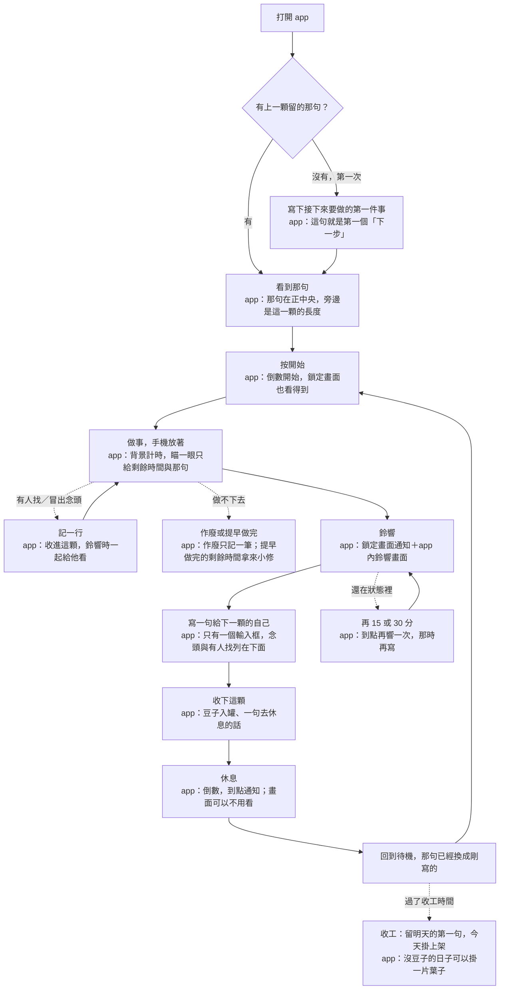

# 豆帳｜流程與資訊架構（v0.1 暫定）
> **2026-11-18 依舊卡，待重看**：核心動作卡已改成 v0.2（核心動詞從「接」換成「種」）。這份是照舊卡「接」寫的，動到相關畫面前先對新卡重看。

> 依 `01-核心動作卡-暫定.md`（核心動詞「接」，閘門 1 未過）做的，所以整份標暫定。卡上「成功的感覺」還空著，倒畫起點用「收下這顆、放下手機」代替，多米填了之後要回來對一次。
> 縮短路徑：命中 3-2「內容少於二十項」，卡片分類省掉；樹狀測試做五人紙本版，待測。另命中「搬既有產品到 iPhone」：進入點整段重列。
> 平台事實查證日 2026-10-31，標在各處；真機能驗的留給 feel。

---

## 1. 核心迴圈（倒著畫）

```
〔成功的感覺，待多米填〕
  ← 收下這顆：豆子入罐，一句「去休息」。這是結尾，給放下手機的理由（2-9）
  ← 寫一句給下一顆的自己（核心動詞）
  ← 鈴響：把人從工作叫回手機。手機多半不在手上，所以鈴響要出現在鎖定畫面（2-12）
  ← 做一顆：app 在背景，使用者不該看它。畫面只要能瞄一眼剩多少
  ← 按開始
  ← 看到上一顆留的那句：這是「接」的另一半，沒有它，寫那句就白寫
  ← 打開 app
```

每一格都答得出「它怎麼幫最後那一刻」。原型裡在迴圈上、但答不出或答得勉強的格子：

| 原型裡的格子 | 它怎麼幫「接」 | 處置 |
|---|---|---|
| 待機畫面的「類型」chip（一般 25 分） | 不幫接，幫對帳。但換類型是每天會做的事 | 留在主畫面，降為配角，不在迴圈主線 |
| 「這件事估幾顆」 | 不幫接，幫對帳 | 移出迴圈，進任務 4（回看）的前置，入口放在類型旁 |
| 計時中「冒出念頭／有人找」 | 間接幫：保住這顆不被打斷，念頭留到鈴響畫面一起看 | 留，當計時中的次要動作（任務 3） |
| 鈴響畫面「在狀態裡，再做一下」 | 幫：把「寫一句」延到真的停下來那一刻 | 留，當鈴響的岔路，只准一次 |
| 鈴響畫面「畫面就是線索」（不寫就收） | **反著幫**：給核心動詞開了逃生口。每天按它的人，豆帳對他就只是番茄鐘 | ❓ 多米決定：刪、或改成「留白也要多按一下」的摩擦 |
| 休息倒數 | 結尾的一部分，但使用者這時該離開螢幕 | 留，最小化；休息結束靠通知，不靠看畫面 |
| 收工、豆棚、收據、葉子 | 不在一次使用的迴圈裡 | 移到任務 4、5 |

## 2. 任務路徑（這五句就是樹狀測試的題目）

1. **開工**：打開豆帳，看昨天留的那句，開始一顆。
2. **鈴響**：手機在桌上響了，寫一句給下一顆，收下這顆，去休息。
3. **中途**：做到一半有人找你，記一筆不中斷；或這顆做不下去了，作廢它。
4. **回看**：看這週收了幾顆豆、估的準不準。
5. **收工**：今天最後一顆做完，留明天的第一句，把今天掛上架。

設定（改類型長度、聲音、備份）是周邊，不出題，只列在畫面清單。



## 3. 四條岔路

| 路徑 | 第一次 | 沒有內容 | 失敗 | 被打斷 |
|---|---|---|---|---|
| 1 開工 | 沒有那句：直接給輸入框寫「第一件事」，不問名字、不教學、不要權限（2-2、3-6） | 不適用 | 不適用（全程離線，沒有網路岔路） | 寫第一件事打到一半被系統結束：草稿要在（原型有 draft，只在 bell 階段，待機階段沒有，**要補**） |
| 2 鈴響 | 第一顆響：鈴響畫面要讓人一眼懂「寫一行」，不靠說明頁 | 沒寫就想收：見 ❓「畫面就是線索」 | 通知權限被拒：鈴只在 app 前景響 → 這不是錯誤，是狀態，待機畫面要說「鈴只在打開時響」並給一條去設定的路（2-8 第五條） ／ 手機靜音：靠橫幅與震動，不靠聲音（2-4、2-11） | 鈴響時人不在：回來時鈴響畫面還在等（原型 ✓）／寫一句打到一半來電：草稿在（原型 ✓）／鈴響後過很久才回來：休息時間早過了，收下後直接回待機，不再倒數休息（原型會從收下時刻開始算休息，**要改**，留給 3-6） |
| 3 中途 | 第一次看到「記一筆」：名稱要讓人懂是「先記著，等下再處理」 | 不適用 | 不適用 | 記一筆打到一半鎖屏：這是一行字，接受丟失或存草稿，待定／作廢到一半：取消就是取消，不是錯誤（2-8） |
| 4 回看 | 豆棚是空的：寫「第一顆響完，這裡才會有」，不放假資料（3-6） | 這週沒豆子；整天開會的日子掛葉子 | 不適用 | 看收據時被切走：回來停在同一頁（堆疊保留） |
| 5 收工 | 第一次收工：明天的第一句預填成最後一顆寫的那句（原型 ✓） | 今天沒豆子：給葉子，不算缺（原型 ✓） | 不適用 | 收工寫到一半被結束：草稿要在，**要補** |
| 設定 | 只有「一般 25 分」一種類型 | — | 匯入檔讀不懂：說「這個檔案讀不懂，原本的資料沒動」（2-8 錯誤訊息三件事）／清空資料是唯一真不可逆的動作，才配確認框，標題寫後果 | — |

計時本身被打斷（鎖屏、切 app、被系統結束、重開機）：原型用結束時刻算剩餘，不用累加，所以回來不會跑掉（✓）。原生版沿用。鈴響那一刻 app 不在前景時，由本地通知負責叫人（見進入點）。

## 4. 進入點

| 進入點 | 落在哪 | 怎麼回主線 | 狀態 |
|---|---|---|---|
| 主畫面圖示 | 主畫面，依狀態顯示待機／計時中／鈴響／休息 | 它就是主線 | 定 |
| 鈴響通知（這顆到點） | 鈴響畫面（寫一句） | 寫完即回主畫面休息 | 定。交易型通知：使用者自己開的那顆番茄有了結果，不是 app 想要他回來（2-12）。權限在第一顆開始時才問，先用自己的畫面說「到點時叫你，只會這一種」（3-6 排時刻表） |
| 休息結束通知 | 主畫面待機 | 就是主線 | 定。同一類授權 |
| 鎖定畫面／動態島的倒數（Live Activity） | 點了進主畫面計時中 | 就是主線 | ❓ 做不做。查證 2026-10-31：倒數可由系統依結束時刻自己畫，app 不用活著 🟢；到點時要結束這個活動需要 app 在跑或推播 🟡，真機驗（feel） |
| 主畫面小工具 | 顯示下一步那句＋今天幾顆；若做互動按鈕「開始」，用 App Intent 在小工具裡直接開始，不打開 app（iOS 17 起 🟢，查證 2026-10-31） | 點那句進主畫面 | ❓ 做不做；不做清單第 11 條待多米 |
| 控制中心按鈕／動作按鈕 | 直接開始一顆（App Intent，iOS 18 起 🟢） | 不進 app | ❓ 之後 |
| 捷徑／Siri／Spotlight | 「開始一顆番茄」「我的下一步是什麼」 | 不進 app 或進主畫面 | ❓ 之後 |
| 分享 | 無。豆帳不分享任何東西出去 | — | 定（除非不做清單改） |
| 深層連結、通用連結 | 無 | — | 定 |

所有進入點都落在主畫面或鈴響畫面，沒有人會被送進深處；所以不需要「回主線」的特別設計。

## 5. 畫面清單

結構原則（2-5）：主要畫面只有一個，**不做分頁列**（2-5 失效 2）。豆棚是低頻的回看層，設定更低頻，兩者都從主畫面用看得見的按鈕進，推進或模態。這直接取代原型的「左右滑三頁＋三個圓點」。多米 2026-10-31 定案：左上「豆棚」、右上「設定」兩個看得見的按鈕，不保留滑動。

| 畫面 | 結構 | 唯一主角 | 從哪來 | 回哪去 | 要處理的狀態 |
|---|---|---|---|---|---|
| 主畫面・待機 | 根畫面 | 上一顆留的那句 | 啟動、小工具、休息結束通知、鈴響收下後 | — | 第一次（沒那句：寫第一句後直接「開始這顆」，一步）；通知被拒的狀態提示；過收工時間浮出「收工」 |
| 主畫面・計時中 | 同一畫面變形，不是新畫面 | 剩餘時間（這時使用者只瞄一眼；那句是配角） | 按開始 | 鈴響 | 被系統結束後還原；記一筆的計數 |
| 主畫面・休息 | 同一畫面變形 | 休息剩餘時間 | 收下這顆 | 待機 | 休息結束靠通知；休息超時只記不罰 |
| 鈴響・寫一句 | 全螢幕模態（它就是這顆的終點，擋住一切是對的） | 輸入框 | 計時到點、鈴響通知 | 主畫面休息 | 草稿；念頭與有人找列在框下；很久才回來；「再做一下」只准一次；留白要多按一下「這顆不留話」 |
| 結束這顆 | 半頁模態 | 選項清單（提早做完／作廢） | 計時中 | 計時中或待機 | 不到五分鐘停下不留紀錄（限制，2-8）；取消不是錯誤 |
| 記一筆 | 半頁模態 | 一行輸入框 | 計時中 | 計時中 | 兩種（念頭／有人找）共用一個畫面 |
| 作廢原因 | 半頁模態 | 原因選項 | 結束這顆 | 待機 | — |
| 類型與估算 | 半頁模態 | 類型清單 | 待機的類型配角 | 待機 | 第一次只有一種；估幾顆在這裡的第二段 |
| 再做一下 | 半頁模態 | 15／30 兩個選項 | 鈴響 | 計時中 | 只出現一次 |
| 豆棚 | 推進（堆疊） | 這週的豆莢 | 主畫面可見入口；收工後 | 主畫面 | 空；葉子日 |
| 一天的收據 | 推進 | 那天的豆子清單 | 豆棚點某一天 | 豆棚 | 葉子日 |
| 一週的收據 | 推進 | 估算對帳 | 豆棚「翻到背面」 | 豆棚 | 這週沒豆子 |
| 收工 | 半頁模態 | 明天的第一句 | 主畫面（過收工時間）、豆棚 | 主畫面待機 | 沒豆子 → 葉子；草稿 |
| 設定 | 模態（全頁） | 設定清單 | 主畫面右上 | 主畫面 | 權限被拒的說明與去系統設定的路；匯入失敗；清空的確認框 |
| 匯出／匯入 | 系統分享與檔案選取 | — | 設定 | 設定 | 讀不懂的檔 |

十五個畫面，一個根畫面，零分頁。其中「主畫面」三個狀態算一個畫面的變形，原型已經這樣做了，沿用。

## 6. 路徑長度（看猶豫與退回，不數點擊）

- **路徑 1 開工**：打開→看那句→按開始。一下。沒有可猶豫的地方。
- **路徑 2 鈴響**：鈴響→寫→收。一個輸入、一個按鈕。猶豫點有兩個：「畫面就是線索」和「再做一下」並排在輸入框下，三個出口會讓人停一下想。「再做一下」只准一次所以第二次會消失，剩「畫面就是線索」看 ❓ 結果。
- **路徑 3 中途**：計時中→記一筆→回。要讓人不猶豫，「有人找」與「念頭」兩個名字得讓人瞬間分得開；分不開就合成一個「記一筆」。留給樹狀測試與 tokens 詞彙表。
- **路徑 4 回看**：主畫面→豆棚→某一天／翻到背面。「翻到背面」是開發者的隱喻，樹狀測試要看它會不會讓人退回。
- **路徑 5 收工**：只在過收工時間後浮出。沒看到入口的人會去豆棚找，豆棚也有，兩個入口通同一頁（像 3-2 阿綠的購買）。

## 7. 結構走查（Agent 查漏，不是測試）

- 每個畫面都有「從哪來／回哪去」✓
- 每個進入點都落在主畫面或鈴響畫面 ✓
- 五條路徑四條岔路都列了；三處標「要補」（待機草稿、收工草稿、鈴響後很久才回來）、一處 ❓（畫面就是線索）
- 2-8 絕不弄丟：計時用結束時刻 ✓、鈴響草稿 ✓、待機與收工草稿 ✗ 要補 → 2026-10-31 落點寫在 `06-首次體驗-暫定.md` 第五節

## 8. 結構樹與樹狀測試包（五人紙本版，待測）

```
豆帳
  開始一顆
  換類型／估幾顆
  正在做
    記一筆：念頭
    記一筆：有人找
    結束這顆
  響了
    寫一句給下一顆
    再做 15 分／30 分
  收工（過收工時間才出現）
  豆棚
    這週
      某一天
      翻到背面：這週的收據
    上週、再上週……
  設定
    任務類型（名稱、長度）
    節奏（休息怎麼算、收工時間）
    提醒（通知、聲音）
    手感（傾斜手機豆子會滾）
    備份（匯出、匯入）
    清空所有資料
```

**做法**：印出來，每一層用紙蓋住，請人用手指點，點了才掀下一層。找五個沒看過豆帳、會用番茄鐘工作的人；多米自己與認識豆帳的人不算（元邊界 7、公理 10）。

**題目**（照第 2 節）：
1. 你昨天做到一半，今天想接著做，第一步會點哪裡？
2. 鈴響了，你要把下一步寫下來，點哪裡？
3. 做到一半同事來問事情，你想先記著等下處理，點哪裡？
4. 想看這週做了幾顆、估的準不準，點哪裡？
5. 今天不做了，想把今天結掉、留一句給明天，點哪裡？

**記錄表**

| 受測者 | 題 | 第一下點哪 | 完整路徑 | 有退回？ | 最後停在哪 | 成功 Y/N | 直接 Y/N | 他說了什麼 |
|---|---|---|---|---|---|---|---|---|

成功但一路退回＝標籤讓人沒把握；很快很篤定走錯＝標籤讓人誤會。分開記。
特別要看的名字：「豆棚」「收據」「翻到背面」「收工」「作廢」「記一筆」。這些全是開發者的隱喻，使用者自己叫它們什麼，記下來給 tokens 詞彙表（2-14）。

## 9. 樹狀測試結果

待測。

## 10. ❓ 等多米決定

| ❓ | 選項與代價 |
|---|---|
| 「畫面就是線索」留不留 | **多米 2026-10-31 定案：B 改成摩擦。** 留白時要多按一下「這顆不留話」（名字待 tokens 詞彙表定），收據上那顆標記沒留話。不再並排在主按鈕旁當同等出口。 |
| 導覽：豆棚與設定怎麼進 | **多米 2026-10-31 定案：A。** 主畫面左上「豆棚」、右上「設定」兩個看得見的按鈕，豆棚推進、設定模態。左右滑拿掉，不當捷徑。 |
| Live Activity、小工具、控制中心 | 三個都是「不打開 app 也看得到／做得到」（2-12 第七條），都幫「接」：小工具顯示那句最貼核心。代價是三個都要獨立驗，建議排序：小工具（顯示那句）→ Live Activity（倒數）→ 控制中心。**2026-10-31：這一輪全部標「之後」，核心迴圈做對再回來。** 另查證：三項在 Expo Go 都不可用，要 development build（EAS），環境與決定一致。 |

## 11. 交出去

- 畫面清單 → `domi-uiux-wireframe`。豆罐手感與 Live Activity 真機行為 → `domi-uiux-feel`，可平行。
- 「要處理的狀態」欄與三處「要補」→ `domi-uiux-onboard`（3-6）。
- 進入點表 → `domi-uiux-launch` 當埋點。
- 樹狀測試裡使用者自己叫東西的名字 → `domi-uiux-tokens` 詞彙表。
